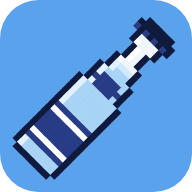
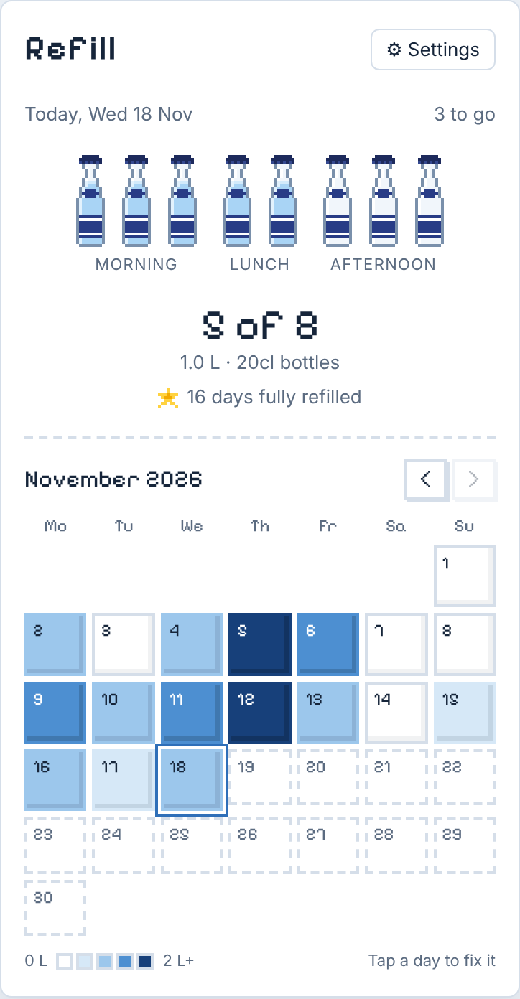
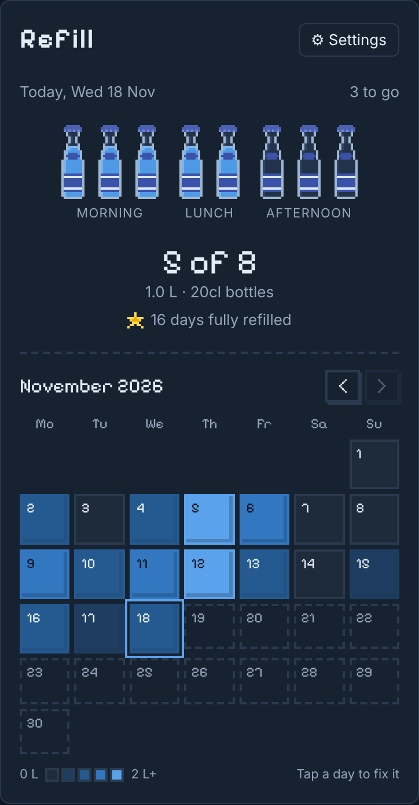
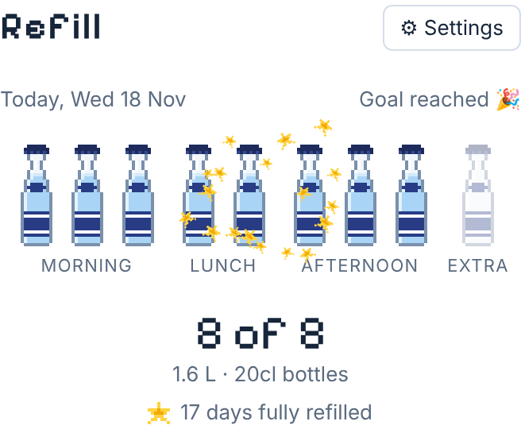
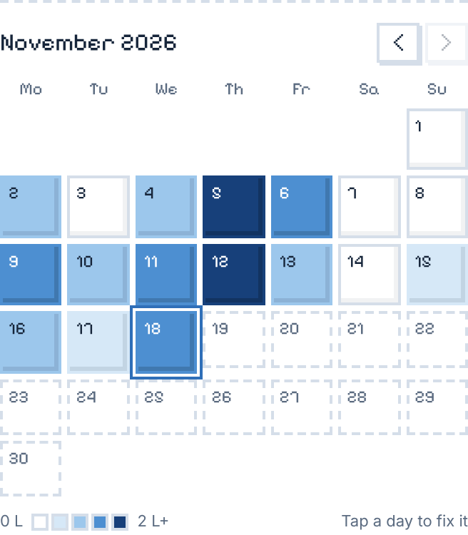
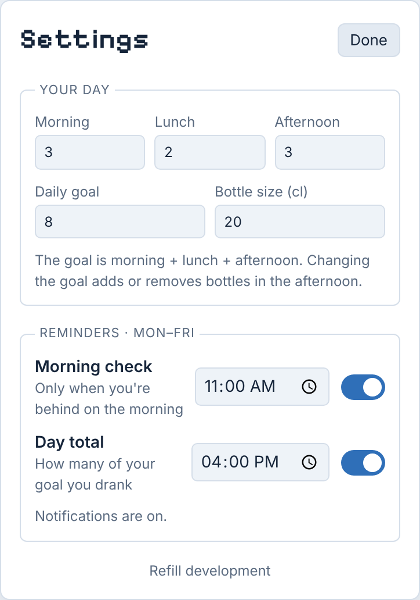

  

<h1 align="center">Refill</h1>

Refill helps me hydrate by tracking the water bottles I drink daily.

  
  &nbsp;
  

It is a small static web app: no build, no framework, no runtime dependencies.
Your data stays in the browser's localStorage. The fonts are bundled, so
nothing is fetched from other sites.

## What it does so far

- Shows the day's bottles in the morning, lunch and afternoon parts, drawn as
  pixel art. Tap a bottle to log the next one; tap a logged bottle to undo.
- Shows "N of G" and the litres, and how many are left to go.
- Counts the days you've been fully refilled, meaning you reached your goal,
  since the beginning, for example "23 days fully refilled". Weekend days
  count too, and a missed day never resets it.
- Past the daily goal it adds an extra bottle, and a burst of stars marks
  reaching the goal.

  
- Shows a month calendar below the bottles, one blocky square per day, shaded
  by how much you drank (0 L up to 2 L+). Step back and forward through the
  months with the arrows, as far back as September 2026.

  
- Tap a past day to fix it: the bottles show that day, with a "Fixing" bar,
  and tapping a bottle changes only that day. "Back to today" (or tapping
  today) returns.
- Settings: the bottles in each part, the daily goal (changing it adds or
  removes bottles in the afternoon), the bottle size, and the morning check and
  day total reminders (on or off, and the time). Lowering the goal never
  removes bottles you already logged. The bottom of Settings shows which
  version is running: the commit and its date, or "development" when run
  locally.

  
- Reminders, Monday to Friday: the morning check (only when you are behind on
  the morning) and the day total show as notifications at their times, once a
  day, and up to an hour late if the app was closed then. Open the app and turn
  notifications on in Settings ("Turn on"); if Windows or your company blocks
  them, Settings says so. After midnight the app moves on to the new day by
  itself.

## Install it

1. Open https://sophiedc98.github.io/refill/ in Edge.
2. Choose ⋯ → Apps → Install this site as an app. Refill then opens in its own
   window and works offline.
3. Allow notifications for the site in Edge's settings, then turn them on in
   the app's Settings.
4. Optional: to start it at sign-in, open edge://apps, pick Refill and turn on
   "Start app at sign-in".

If installing is blocked, pin the browser tab instead.

## Reinstall it

Do this when Windows keeps showing an old taskbar icon after an update. Your
counts and settings stay, as long as you leave "clear data" unticked.

1. Uninstall: in the Refill window, open ⋯ (top right) → App settings →
   Uninstall. Or open edge://apps in Edge, click ⋯ next to Refill and choose
   Uninstall. Or use Windows Settings → Apps → Installed apps → Refill →
   Uninstall.
2. When asked, leave "Also clear data from Microsoft Edge" **unticked**.
   Ticking it deletes your history.
3. If you pinned Refill to the taskbar, right-click its old icon and choose
   "Unpin from taskbar".
4. Install again: open https://sophiedc98.github.io/refill/ in Edge and choose
   ⋯ → Apps → Install this site as an app.
5. Pin it again: right-click Refill in the taskbar and choose "Pin to
   taskbar". To start it at sign-in, turn that on again in edge://apps.

## Run it locally

- `node scripts/readme-shots.mjs` retakes the screenshots in this README, with
  made-up example history.
- Every push to `main` publishes the site through GitHub Actions
  (`.github/workflows/pages.yml`), which stamps the commit into the app. In the
  repository's Settings → Pages, the source must be "GitHub Actions".

- `npm run serve` serves the app; open http://localhost:8000.
- `npm test` runs the unit tests.
- `npm run test:smoke` runs the smoke tests (needs Playwright installed).
